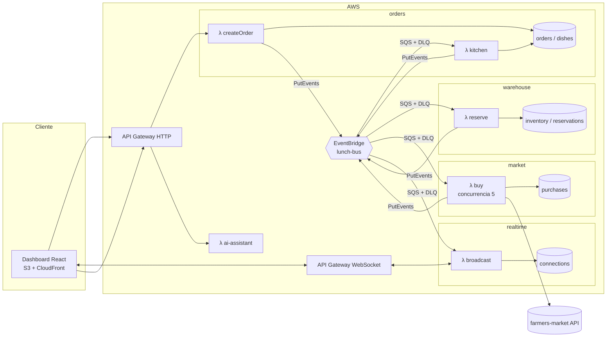
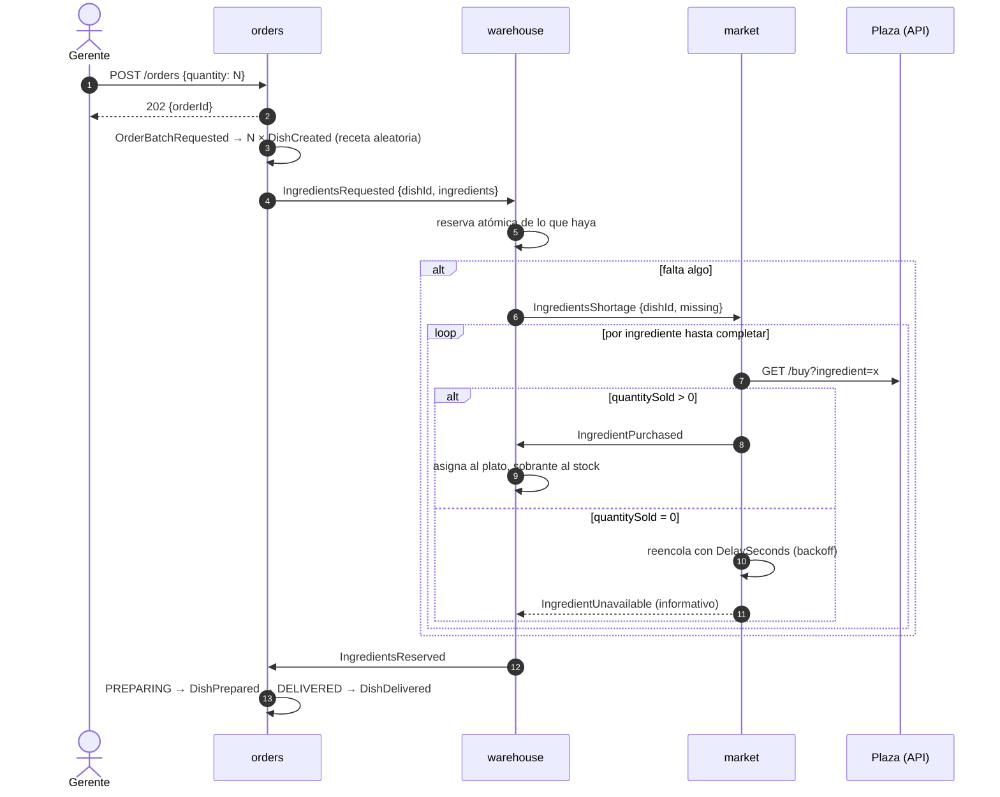

# Arquitectura

El sistema son cinco microservicios serverless en AWS que se comunican solo por eventos. Esta página es la referencia viva del diseño. La vista general y el plan están en [PLANNING.md](PLANNING.md), y el porqué de cada decisión en [adr/](adr/).

## Componentes



Cada consumidor tiene su cola SQS con DLQ entre el bus y el Lambda. La cola absorbe ráfagas, reintenta y aplica backpressure. Una regla de EventBridge por consumidor filtra solo los `detail-type` que le interesan.

## Flujo de un plato



## Contratos

Todos los eventos están definidos en [`packages/contracts`](../packages/contracts/src/events/index.ts) con zod. El `detail` de cada evento de EventBridge tiene siempre la misma forma:

```json
{
  "metadata": {
    "eventId": "uuid",
    "occurredAt": "ISO-8601",
    "version": 1,
    "correlationId": "dishId"
  },
  "payload": { "...": "según el evento" }
}
```

- El productor valida al crear el evento (`createEvent`), y el consumidor valida al recibirlo.
- Un cambio incompatible sube `version` y convive con la versión anterior hasta que todos los consumidores migren.
- `correlationId` es el `dishId` (o el `orderId` antes de que existan platos). Sirve para seguir un plato de punta a punta en los logs y en X-Ray.

## Modelo de datos

| Servicio  | Tabla          | Clave                              | Atributos principales                                          |
| --------- | -------------- | ---------------------------------- | -------------------------------------------------------------- |
| orders    | `orders`       | `PK=ORDER#id`                      | `quantity`, `createdAt`, contadores por estado                 |
| orders    | `dishes`       | `PK=DISH#id`; GSI por `status`     | `orderId`, `recipeId`, `status`, timestamps por transición     |
| warehouse | `inventory`    | `PK=INGREDIENT#name`               | `stock` (nunca negativo, por condición)                        |
| warehouse | `reservations` | `PK=DISH#id`, `SK=INGREDIENT#name` | `needed`, `reserved`                                           |
| market    | `purchases`    | `PK=PURCHASE#id`; GSI por fecha    | `dishId`, `ingredient`, `requested`, `quantitySold`, `attempt` |
| realtime  | `connections`  | `PK=CONNECTION#id`                 | TTL de 2 h                                                     |

## Reserva de ingredientes

Algoritmo por ingrediente de un plato, en `warehouse`:

1. `faltante = needed − reserved`. Si es 0, terminó.
2. Lee `stock`; toma `n = min(stock, faltante)`.
3. `UpdateItem inventory SET stock = stock − n IF stock >= n`. Si la condición falla, otro plato ganó la carrera: vuelve al paso 2.
4. `UpdateItem reservations SET reserved = reserved + n`.
5. Si sigue faltando, publica `IngredientsShortage` con lo que falta.

Cuando llega `IngredientPurchased`, se asigna `min(quantitySold, faltante)` al plato y el resto suma al `stock`. Cuando todos los ingredientes del plato tienen `reserved = needed`, publica `IngredientsReserved` (una sola vez, con escritura condicional).

No hay deadlock: ningún plato espera a que otro libere stock, porque todo faltante se compra. El detalle y las alternativas están en [ADR 0003](adr/0003-atomic-partial-reservations.md).

## Fallos y reintentos

| Situación                   | Comportamiento                                                                                      |
| --------------------------- | --------------------------------------------------------------------------------------------------- |
| La plaza vende 0            | Reintento con `DelaySeconds = min(60, 2^intento) + jitter`; el plato sigue en `WAITING_INGREDIENTS` |
| La plaza da timeout o 5xx   | Error técnico: reintento de SQS; tras 5 intentos va a DLQ y salta la alarma                         |
| Mensaje duplicado           | Escritura condicional por `dishId + paso`; el duplicado no tiene efecto                             |
| Falla un mensaje en un lote | `ReportBatchItemFailures`: solo ese mensaje se reintenta                                            |
| Reinicio o redeploy         | Todo el estado vive en DynamoDB; las colas conservan lo pendiente                                   |
