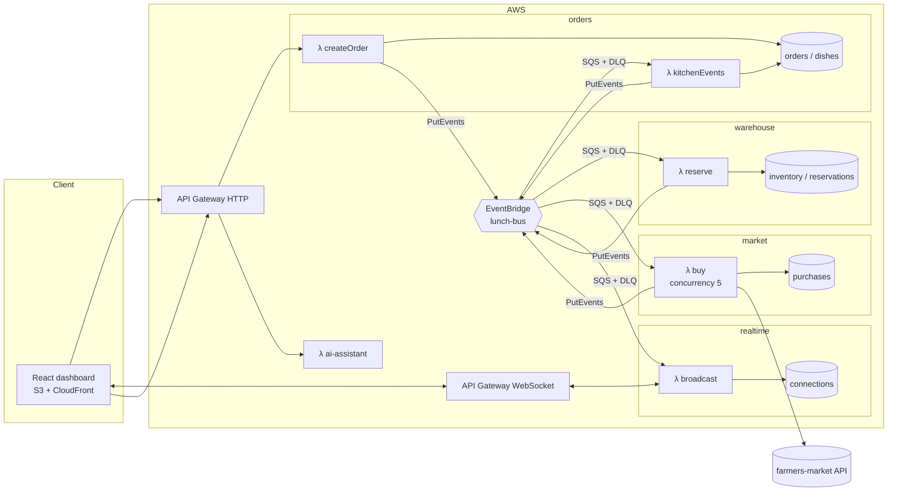
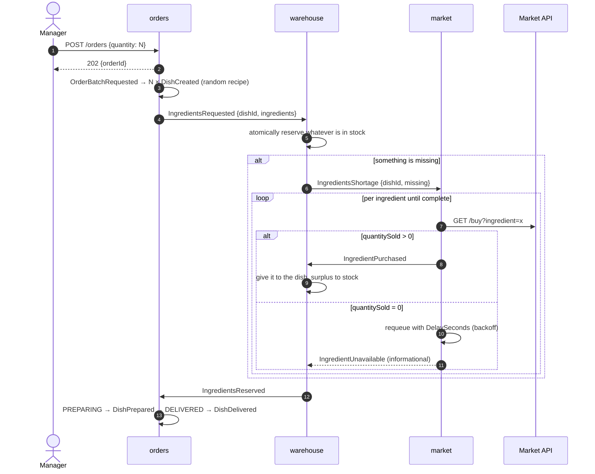

# Architecture

The system is five serverless microservices on AWS that communicate only through events. This page is the living reference for the design. The overview and the plan are in [PLANNING.md](PLANNING.md), and the reasoning behind each decision is in [adr/](adr/).

## Components



Each consumer has its own SQS queue with a DLQ between the bus and its Lambda. The queue absorbs bursts, retries and applies backpressure. One EventBridge rule per consumer forwards only the `detail-type`s it cares about. The rule, queue, DLQ and queue policy come from one shared template, [`infra/templates/event-subscription.mjs`](../infra/templates/event-subscription.mjs).

## Life of a dish



## Contracts

Every event is defined in [`packages/contracts`](../packages/contracts/src/events/index.ts) with zod. The `detail` of every EventBridge event has the same shape:

```json
{
  "metadata": {
    "eventId": "uuid",
    "occurredAt": "ISO-8601",
    "version": 1,
    "correlationId": "dishId"
  },
  "payload": { "...": "per event" }
}
```

- The producer validates when it builds the event (`createEvent`), and the consumer validates on receipt.
- A breaking change bumps `version` and lives alongside the old version until every consumer migrates.
- `correlationId` is the `dishId` (or the `orderId` before dishes exist). It follows a dish end to end through logs and X-Ray.

## Data model

| Service   | Table          | Key                       | Main attributes                                                |
| --------- | -------------- | ------------------------- | -------------------------------------------------------------- |
| orders    | `orders`       | `orderId`                 | `quantity`, `createdAt`                                        |
| orders    | `dishes`       | `dishId`; GSI `byOrder`   | `orderId`, `recipeId`, `status`, `createdAt`, `updatedAt`      |
| warehouse | `inventory`    | `ingredient`              | `stock` (never negative, enforced by a condition)              |
| warehouse | `reservations` | `dishId`                  | per ingredient: `needed`, `reserved`                           |
| market    | `purchases`    | `purchaseId`; GSI by date | `dishId`, `ingredient`, `requested`, `quantitySold`, `attempt` |
| realtime  | `connections`  | `connectionId`            | 2 h TTL                                                        |

An order's per-status counts are computed on read from its dishes (GSI `byOrder`). Stored counters on the order item would make it a hot item: every dish of a burst writes to it and concurrent transactions on one item get rejected (`TransactionConflict`).

## Ingredient reservation

The algorithm per ingredient of a dish, in `warehouse`:

1. `missing = needed − reserved`. If it is 0, done.
2. Read `stock`; take `n = min(stock, missing)`.
3. In one transaction: `stock = stock − n IF stock >= n` and `reserved = reserved + n IF reserved = :seen`. If a condition fails, another dish won the race: go back to step 2.
4. If something is still missing, publish `IngredientsShortage` with what is missing.

When `IngredientPurchased` arrives, `min(quantitySold, missing)` goes to the dish and the rest goes to `stock`. Once every ingredient of the dish has `reserved = needed`, it publishes `IngredientsReserved`.

There is no deadlock: no dish waits for another one to release stock, because every shortage gets bought. Details and alternatives are in [ADR 0003](adr/0003-atomic-partial-reservations.md).

## Failures and retries

| Situation                      | Behavior                                                                                      |
| ------------------------------ | --------------------------------------------------------------------------------------------- |
| The market sells 0             | Retry with `DelaySeconds = min(60, 2^attempt) + jitter`; the dish stays `WAITING_INGREDIENTS` |
| The market times out or is 5xx | Technical error: SQS retries; after 5 attempts it goes to the DLQ and the alarm fires         |
| Duplicate message              | Conditional write keyed by `dishId + step`; the duplicate has no effect                       |
| One message of a batch fails   | `ReportBatchItemFailures`: only that message is retried                                       |
| Restart or redeploy            | All state lives in DynamoDB; queues keep whatever is pending                                  |
