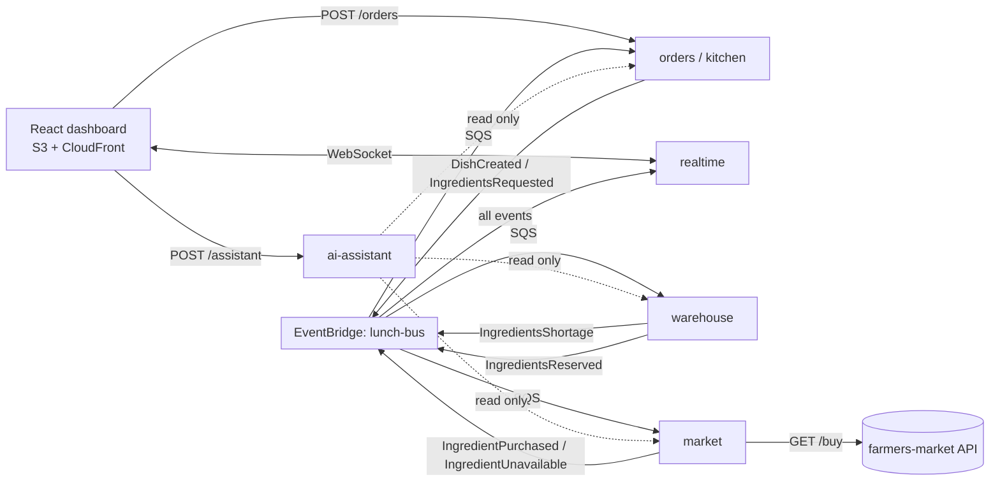
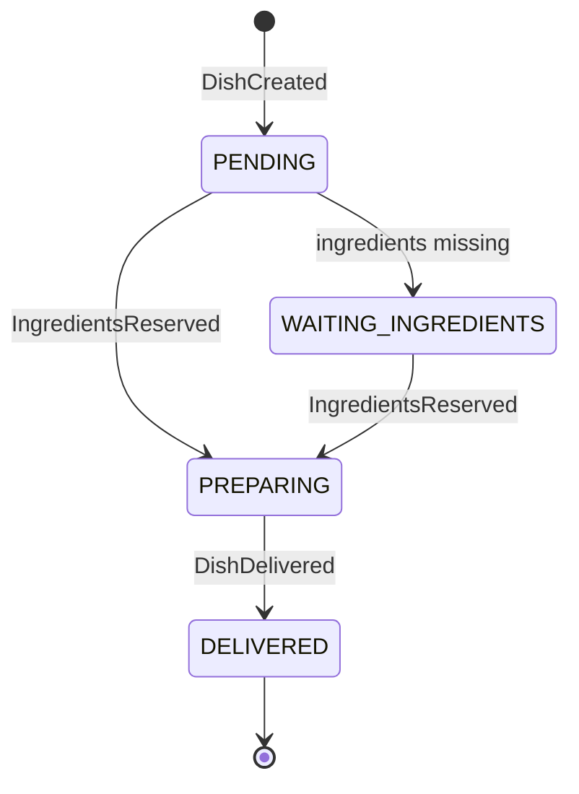

# PLANNING — Free Lunch Day

> Written before the first line of code. It shows how I read the problem, what I decided and how I organized seven days of work. The decisions that matter most have an ADR in `docs/adr/`.

## 1. Goal

Ship a **serverless, event-driven system on AWS, publicly deployed**. It takes massive dish orders and resolves ingredients against a small warehouse and a farmers market that sometimes sells nothing. Every dish is delivered with no manual step, and the manager watches it all in real time.

Measurable success criteria:

| Criterion             | Target                                                 |
| --------------------- | ------------------------------------------------------ |
| Order button response | `202 Accepted`, p95 < 300 ms                           |
| A 1,000-dish burst    | 0 lost dishes, 0 duplicates, all `DELIVERED`           |
| Inventory             | Never negative, even with 50 managers clicking at once |
| Restarts / redeploys  | State survives (DynamoDB persistence)                  |
| Automation            | Zero manual steps from order to delivery               |
| AI                    | Working in the deployment, with guardrails, documented |

## 2. Reading of the brief and assumptions

| Topic            | What the brief says                                                     | How I interpret it                                                                                                                   |
| ---------------- | ----------------------------------------------------------------------- | ------------------------------------------------------------------------------------------------------------------------------------ |
| Order            | The manager orders "X" dishes with a button                             | `POST /orders { quantity }`, capped per click (1–500), with an `Idempotency-Key` against double clicks                               |
| Recipes          | 6 recipes I define, each using ingredients from the list                | 6 fixed recipes with a quantity per ingredient; together they use all 10 ingredients                                                 |
| Warehouse        | Starts with 5 units of each ingredient                                  | Initial stock of 5 × 10 ingredients; a "reset the day" action restores it                                                            |
| Market           | `GET /buy?ingredient=x` → `{ quantitySold }`; 0 = none                  | Verified: returns `{"quantitySold":2}`; an invalid ingredient returns `400`. It may sell less or more than is missing                |
| What gets bought | Buy "what is missing"                                                   | Everything sold enters the warehouse; the dish that asked for it gets its share first, the rest is general stock                     |
| Deduction        | Ingredients are deducted when the dish is prepared                      | The atomic **reservation** is the deduction; a dish moves to `PREPARING` only once it has everything                                 |
| Missing stock    | No limit is given                                                       | A dish **never fails for lack of ingredients**: it waits and the purchase is retried with backoff. Only technical errors go to a DLQ |
| Stack            | Node/TS without Express, Nest or other frameworks; serverless is a PLUS | Lambdas with plain TypeScript handlers; utility libraries only (AWS SDK, Powertools, zod)                                            |

## 3. Architecture on one page

Five independent microservices. Each one has its own `serverless.yml`, its own DynamoDB tables and its own deployment. They talk **only through events** (EventBridge plus one SQS queue with a DLQ per consumer). No service calls another over HTTP, and only `market` talks to the external API.

| Service        | Responsibility                                                   | Owned data                  |
| -------------- | ---------------------------------------------------------------- | --------------------------- |
| `orders`       | Takes the order, assigns random recipes, drives each dish's life | `orders`, `dishes`, recipes |
| `warehouse`    | Inventory, atomic and partial reservations per dish              | `inventory`, `reservations` |
| `market`       | Buys at the market with retries, backoff and bounded concurrency | `purchases` (history)       |
| `realtime`     | Pushes changes to the dashboard over WebSocket                   | `connections`               |
| `ai-assistant` | Manager copilot with tool calling over live data                 | — (read only)               |

### Dish lifecycle

Every transition is a conditional write on the current status. A duplicated event can neither move a dish backwards nor deliver it twice.

### Event contracts

They live in `packages/contracts` as versioned zod schemas, the single source of truth between services.

1. `OrderBatchRequested` → `DishCreated` (one per dish)
2. `IngredientsRequested` (orders → warehouse)
3. `IngredientsShortage` (warehouse → market, with what each dish is missing)
4. `IngredientPurchased` / `IngredientUnavailable` (market → warehouse)
5. `IngredientsReserved` (warehouse → orders) → `DishPrepared` → `DishDelivered`

## 4. Key decisions

| Decision              | Chosen                                                      | Rejected alternative                                       | ADR                                             |
| --------------------- | ----------------------------------------------------------- | ---------------------------------------------------------- | ----------------------------------------------- |
| Deployment            | Serverless Framework v4, Lambda Node.js 22 + esbuild, ARM64 | Containers on ECS/EC2 with a Dockerfile per service        | [0001](adr/0001-serverless-over-containers.md)  |
| Communication         | EventBridge + SQS with a DLQ per consumer                   | Synchronous HTTP between services; SNS fan-out             | [0002](adr/0002-event-bus-communication.md)     |
| Inventory concurrency | Atomic, partial reservations with conditional `UpdateItem`  | A FIFO queue with a single group serializing the warehouse | [0003](adr/0003-atomic-partial-reservations.md) |
| Persistence           | On-demand DynamoDB, tables owned per service                | RDS (cost and a server to run)                             | 0001                                            |
| Repository            | Monorepo with npm workspaces                                | One repository per service                                 | —                                               |
| Local development     | `docker-compose` with LocalStack and DynamoDB Local         | Developing only against AWS                                | 0001                                            |

## 5. The three hard problems

1. **Inventory under concurrency.** Hundreds of dishes compete for 5 units. Each ingredient is a DynamoDB item and a reservation uses `UpdateItem` with `ConditionExpression stock >= :n`. When there is not enough, the dish **reserves what is there** and asks the market only for the rest. Purchased units go to that dish first. The market is an infinite source, so there is no deadlock: every shortage is eventually bought.
2. **A market that sells 0.** That is not an error: the message goes back to SQS with `DelaySeconds` and exponential backoff with jitter, capped at 60 s. No `sleep` inside a Lambda. The purchase Lambda has reserved concurrency (5) so it does not overwhelm the external API.
3. **At-least-once delivery.** SQS and EventBridge may duplicate messages. Every handler is idempotent (conditional writes keyed by `dishId + step`), and consumers use `ReportBatchItemFailures` to retry only what failed.

## 6. AI feature: the manager's copilot

**Real problem:** the manager is not technical and will not read tables in the middle of a massive event. They need answers like "why are 12 dishes waiting?" or "what is running out?".

**Solution:** a conversational assistant in the dashboard. It answers through **tool calling** over typed, read-only tools: `getOrderStats`, `getInventory`, `getPurchaseHistory`, `getWaitingDishes`, `getRecipes`. The model never writes data or runs free-form queries, and every number comes from a tool.

Guardrails: requests-per-minute limit, timeout, max tokens and a fallback answer if the provider fails. The details (model, cost per query, why tool calling and not RAG) go in `docs/ai.md`. Stretch goal: an "end-of-day report" button.

## 7. Work plan

Rule: **something working deployed on day 2**, and day 7 kept for polish and docs only. Each task is a 1–3 h issue with acceptance criteria; each PR references its issue.

### Day 1 — Design and foundations

- [x] T-01 `docs/PLANNING.md` (this document), committed before any code
- [x] T-02 `docs/ARCHITECTURE.md` with diagrams and ADRs 0001–0003
- [x] T-03 Monorepo: npm workspaces, strict TS, ESLint, Prettier, Vitest
- [x] T-04 `packages/contracts`: zod schemas for every event + tests
- [x] T-05 `AGENTS.md` / `CLAUDE.md`: conventions for AI agents and humans
- [x] T-06 GitHub Actions CI: lint, typecheck and tests on every PR
- [x] T-07 AWS account with a USD 5 budget alarm

### Day 2 — End-to-end skeleton

- [x] T-08 Shared infrastructure: EventBridge bus
- [x] T-09 `orders`: `POST /orders`, fan-out into dishes, 6 recipes, dishes table
- [x] T-10 `warehouse`: initial stock and reservations (happy path)
- [x] T-11 Happy path deployed: order → warehouse → delivery, no market yet

### Day 3 — Warehouse and market

- [x] T-12 Atomic, partial reservations (tests first)
- [x] T-13 `market`: market client with timeout, `DelaySeconds` backoff and bounded concurrency
- [x] T-14 Purchases go to the dish that asked for them, surplus to stock
- [x] T-15 Purchase history

### Day 4 — Robustness

- [ ] T-16 Idempotency in every handler and a conditional state machine
- [ ] T-17 DLQs, `ReportBatchItemFailures` and alarms
- [ ] T-18 First load test (k6) and fixing whatever breaks

### Day 5 — Frontend and real time

- [ ] T-19 `realtime`: API Gateway WebSocket + event consumer
- [ ] T-20 Dashboard: order button, counters, dishes in progress, inventory, purchase history, order history, recipes
- [ ] T-21 Polling fallback and deployment to S3 + CloudFront

### Day 6 — AI and observability

- [ ] T-22 `ai-assistant` with tool calling and guardrails
- [ ] T-23 Copilot panel in the dashboard
- [ ] T-24 Powertools (logger with `correlationId = dishId`, tracer, metrics) and a CloudWatch dashboard
- [ ] T-25 Final load test with results in `docs/load-testing.md`

### Day 7 — Polish and delivery

- [ ] T-26 User test with a non-technical person, then fixes
- [ ] T-27 5-minute README, `docs/ai.md`, final code review
- [ ] T-28 Private repository with `scouting@alegra.com` as collaborator, submission through the form

**Cut order if time runs short:** AI end-of-day report → WebSocket (polling stays) → CloudWatch dashboard. **Never cut:** atomic reservations, idempotency, load test.

## 8. Definition of done

A task is done when:

- It has tests (unit tests for the domain; integration tests when it touches DynamoDB or queues).
- `npm run lint`, `npm run typecheck` and `npm test` pass.
- It adds no synchronous calls between services, no `sleep` in Lambdas, no unconditional writes and no IAM permissions with `*`.
- If it changes a contract, `packages/contracts` is updated first.

## 9. Risks

| Risk                                            | Mitigation                                                                                                       |
| ----------------------------------------------- | ---------------------------------------------------------------------------------------------------------------- |
| The reviewer expects "dockerized microservices" | Explain in the README that serverless is the PLUS option; `docker-compose` with LocalStack for local development |
| The market returns 0 often and dishes take long | Backoff capped at 60 s; the UI shows "waiting for ingredient X" and the AI explains it                           |
| Unexpected AWS or LLM costs                     | Budget alarm, on-demand DynamoDB, concurrency and token limits                                                   |
| Cold starts during the demo                     | esbuild with small bundles, ARM64                                                                                |
| The URL stops working during the review         | Do not tear down the stack until there is an answer; test the URL from another network on submission day         |

## 10. AI in the development process

I use Claude Code as a pair programmer. I decide the architecture, the contracts and the acceptance criteria; the agent implements small, verifiable tasks. The conventions it must follow are in `AGENTS.md`. I review every diff against the checklist in section 8. The README documents the workflow, with example prompts and what I reviewed by hand.
