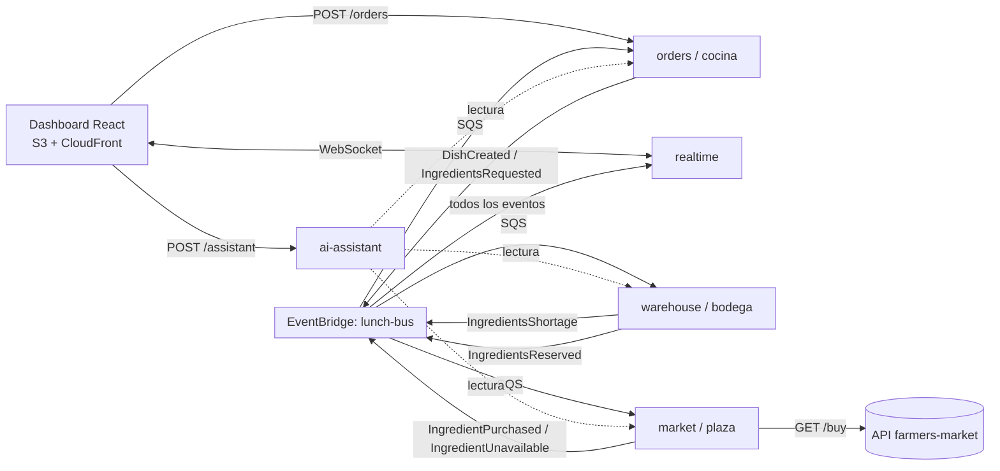
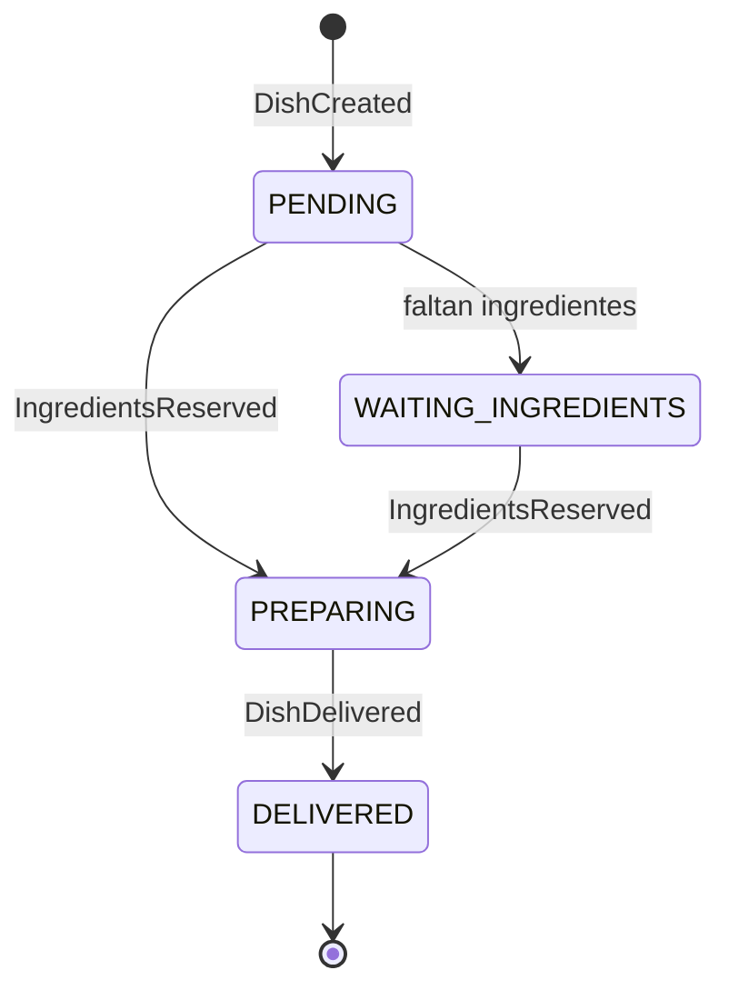

# PLANNING — Jornada de Almuerzo Gratis

> Escrito antes de la primera línea de código. Este documento muestra cómo entiendo el problema, qué decidí y cómo organicé el trabajo de 7 días. Las decisiones con más peso tienen su ADR en `docs/adr/`.

## 1. Objetivo

Entregar un sistema **serverless en AWS, orientado a eventos y desplegado públicamente**. Debe recibir pedidos masivos de platos y resolver ingredientes contra una bodega pequeña y una plaza de mercado que a veces no vende. Entrega cada plato sin intervención manual, y el gerente ve todo en tiempo real.

Criterios de éxito medibles:

| Criterio                             | Meta                                                        |
| ------------------------------------ | ----------------------------------------------------------- |
| Respuesta del botón de pedido        | `202 Accepted`, p95 < 300 ms                                |
| Pedido de 1.000 platos en una ráfaga | 0 platos perdidos, 0 duplicados, todos en `DELIVERED`       |
| Inventario                           | Nunca negativo, ni bajo 50 gerentes haciendo clic a la vez  |
| Reinicios / redeploys                | El estado sobrevive (persistencia en DynamoDB)              |
| Automatización                       | Cero pasos manuales del pedido a la entrega                 |
| IA                                   | Funcional en el despliegue, con guardarraíles y documentada |

## 2. Lectura del enunciado y supuestos

| Tema                 | Lo que dice el reto                                               | Cómo lo interpreto                                                                                                               |
| -------------------- | ----------------------------------------------------------------- | -------------------------------------------------------------------------------------------------------------------------------- |
| Pedido               | El gerente pide "X" platos con un botón                           | `POST /orders { quantity }`, con límite por clic (1–500) e `Idempotency-Key` contra doble clic                                   |
| Recetas              | 6 recetas definidas por mí, cada una con ingredientes de la lista | 6 recetas fijas con cantidades por ingrediente; entre todas cubren los 10 ingredientes                                           |
| Bodega               | Arranca con 5 unidades de cada ingrediente                        | Seed inicial de 5 × 10 ingredientes; un "reinicio de jornada" vuelve a ese estado                                                |
| Plaza                | `GET /buy?ingredient=x` → `{ quantitySold }`; 0 = no disponible   | Verificado: responde `{"quantitySold":2}`; un ingrediente inválido da `400`. Puede vender menos o más de lo que falta            |
| Lo comprado          | Se compra "lo faltante"                                           | Todo lo vendido entra a la bodega; lo que cubre al plato que lo pidió se le asigna primero, el sobrante queda como stock general |
| Descuento            | Se descuenta al preparar                                          | La **reserva** atómica del ingrediente es el descuento; el plato pasa a `PREPARING` solo cuando tiene todo                       |
| Falta de ingrediente | No se especifica un límite                                        | Un plato **nunca falla por falta de ingredientes**: espera y se reintenta la compra con backoff. Solo errores técnicos van a DLQ |
| Stack                | Node/TS sin Express, Nest u otros frameworks; serverless es PLUS  | Lambdas con handlers puros en TypeScript; solo librerías utilitarias (AWS SDK, Powertools, zod)                                  |

## 3. Arquitectura en una página

Cinco microservicios independientes. Cada uno tiene su `serverless.yml`, su tabla DynamoDB y su despliegue. Se comunican **solo por eventos** (EventBridge + una cola SQS con DLQ por consumidor). Ningún servicio llama a otro por HTTP, y solo `market` habla con la API externa.

| Servicio       | Responsabilidad                                                                  | Datos propios                            |
| -------------- | -------------------------------------------------------------------------------- | ---------------------------------------- |
| `orders`       | Recibe el pedido, asigna recetas aleatorias, orquesta el ciclo de vida del plato | `orders`, `dishes` + catálogo de recetas |
| `warehouse`    | Inventario, reservas atómicas y parciales por plato                              | `inventory`, `reservations`              |
| `market`       | Compra en la plaza con reintentos, backoff y concurrencia limitada               | `purchases` (historial)                  |
| `realtime`     | Empuja los cambios al dashboard por WebSocket                                    | `connections`                            |
| `ai-assistant` | Copiloto del gerente con tool calling sobre datos en vivo                        | — (solo lectura)                         |

### Ciclo de vida de un plato

Cada transición es una escritura condicional sobre el estado actual. Un evento duplicado no puede mover un plato hacia atrás ni entregarlo dos veces.

### Contratos de eventos

Viven en `packages/contracts` como esquemas zod versionados. Son la única fuente de verdad entre servicios.

1. `OrderBatchRequested` → `DishCreated` (uno por plato)
2. `IngredientsRequested` (orders → warehouse)
3. `IngredientsShortage` (warehouse → market, con lo que falta por plato)
4. `IngredientPurchased` / `IngredientUnavailable` (market → warehouse)
5. `IngredientsReserved` (warehouse → orders) → `DishPrepared` → `DishDelivered`

## 4. Decisiones clave

| Decisión                    | Elegido                                                     | Alternativa descartada                              | ADR                                             |
| --------------------------- | ----------------------------------------------------------- | --------------------------------------------------- | ----------------------------------------------- |
| Despliegue                  | Serverless Framework v4, Lambda Node.js 22 + esbuild, ARM64 | Contenedores en ECS/EC2 con Dockerfile por servicio | [0001](adr/0001-serverless-over-containers.md)  |
| Comunicación                | EventBridge + SQS con DLQ por consumidor                    | HTTP síncrono entre servicios; SNS fan-out          | [0002](adr/0002-event-bus-communication.md)     |
| Concurrencia del inventario | Reservas atómicas y parciales con `UpdateItem` condicional  | Cola FIFO con un solo grupo que serializa la bodega | [0003](adr/0003-atomic-partial-reservations.md) |
| Persistencia                | DynamoDB on-demand, una tabla por servicio                  | RDS (costo y servidor que mantener)                 | 0001                                            |
| Repositorio                 | Monorepo con npm workspaces                                 | Un repo por servicio                                | —                                               |
| Desarrollo local            | `docker-compose` con LocalStack y DynamoDB Local            | Desarrollar solo contra AWS                         | 0001                                            |

## 5. Los tres problemas difíciles

1. **Inventario bajo concurrencia.** Cientos de platos compiten por 5 unidades. Cada ingrediente es un ítem en DynamoDB y la reserva usa `UpdateItem` con `ConditionExpression stock >= :n`. Si hay menos de lo necesario, el plato **reserva lo que hay** y pide a la plaza solo lo que falta. Lo comprado se asigna primero a ese plato. Como la plaza es la fuente infinita, no hay deadlock: todo faltante termina comprado.
2. **Plaza que vende 0.** No es un error: el mensaje vuelve a SQS con `DelaySeconds` y backoff exponencial con jitter, con tope de 60 s. Nada de `sleep` dentro del Lambda. El Lambda de compras tiene concurrencia reservada (5) para no saturar la API externa.
3. **Entrega al menos una vez.** SQS y EventBridge pueden duplicar mensajes. Todo handler es idempotente (escrituras condicionales por `dishId + paso`), y los consumidores usan `ReportBatchItemFailures` para reintentar solo lo fallido.

## 6. Funcionalidad de IA: Copiloto del gerente

**Problema real:** el gerente no es técnico y no va a leer tablas durante un evento masivo. Necesita respuestas como "¿por qué hay 12 platos esperando?" o "¿qué se está agotando?".

**Solución:** un asistente conversacional en el dashboard. Responde con **tool calling** sobre herramientas tipadas de solo lectura: `getOrderStats`, `getInventory`, `getPurchaseHistory`, `getWaitingDishes`, `getRecipes`. El modelo nunca escribe ni ejecuta consultas libres, y toda cifra sale de una herramienta.

Guardarraíles: límite de peticiones por minuto, timeout, máximo de tokens y respuesta de respaldo si el proveedor falla. El detalle (modelo, costo por consulta, por qué tool calling y no RAG) va en `docs/ai.md`. Extra si sobra tiempo: botón de "reporte de cierre de la jornada".

## 7. Plan de trabajo

Regla: **algo funcional desplegado el día 2**, y el día 7 solo para pulir y documentar. Cada tarea es un issue de 1–3 horas con criterio de aceptación; cada PR referencia su issue.

### Día 1 — Diseño y base

- [ ] T-01 `docs/PLANNING.md` (este documento), commit antes del código
- [ ] T-02 `docs/ARCHITECTURE.md` con diagramas y ADRs 0001–0003
- [ ] T-03 Monorepo: npm workspaces, TS estricto, ESLint, Prettier, Vitest
- [ ] T-04 `packages/contracts`: esquemas zod de todos los eventos + tests
- [ ] T-05 `AGENTS.md` / `CLAUDE.md`: convenciones para agentes de IA y humanos
- [ ] T-06 CI en GitHub Actions: lint, typecheck y tests en cada PR
- [ ] T-07 Cuenta AWS con alarma de presupuesto en USD 5

### Día 2 — Esqueleto de punta a punta

- [ ] T-08 Infra compartida: bus de EventBridge
- [ ] T-09 `orders`: `POST /orders`, fan-out a platos, 6 recetas, tabla de platos
- [ ] T-10 `warehouse`: seed de inventario y reserva simple (camino feliz)
- [ ] T-11 Camino feliz desplegado: pedido → bodega → entrega, sin plaza todavía

### Día 3 — Bodega y plaza

- [ ] T-12 Reservas atómicas y parciales (tests primero)
- [ ] T-13 `market`: cliente de la plaza con timeout, backoff con `DelaySeconds` y concurrencia reservada
- [ ] T-14 Asignación de compras al plato que las pidió y sobrante al stock
- [ ] T-15 Historial de compras

### Día 4 — Robustez

- [ ] T-16 Idempotencia en todos los handlers y máquina de estados condicional
- [ ] T-17 DLQs, `ReportBatchItemFailures` y alarmas
- [ ] T-18 Primera prueba de carga (k6) y corrección de lo que falle

### Día 5 — Frontend y tiempo real

- [ ] T-19 `realtime`: API Gateway WebSocket + consumidor de eventos
- [ ] T-20 Dashboard: botón de pedido, contadores, órdenes en preparación, inventario, historial de compras, historial de pedidos, recetas
- [ ] T-21 Respaldo por polling y despliegue en S3 + CloudFront

### Día 6 — IA y observabilidad

- [ ] T-22 `ai-assistant` con tool calling y guardarraíles
- [ ] T-23 Panel del copiloto en el dashboard
- [ ] T-24 Powertools (logger con `correlationId = dishId`, tracer, métricas) y dashboard de CloudWatch
- [ ] T-25 Prueba de carga final con resultados en `docs/load-testing.md`

### Día 7 — Pulido y entrega

- [ ] T-26 Prueba de usuario con alguien no técnico y ajustes
- [ ] T-27 README de 5 minutos, `docs/ai.md`, revisión final del código
- [ ] T-28 Repo privado con `scouting@alegra.com` como colaborador, envío por el formulario

**Orden de recorte si falta tiempo:** reporte de cierre de IA → WebSocket (queda polling) → dashboard de CloudWatch. **No se recorta:** reservas atómicas, idempotencia, prueba de carga.

## 8. Definición de terminado

Una tarea está terminada cuando:

- Tiene tests (unitarios en el dominio; de integración si toca DynamoDB o colas).
- Pasan `npm run lint`, `npm run typecheck` y `npm test`.
- No agrega llamadas síncronas entre servicios, `sleep` en Lambdas, escrituras sin condición ni permisos IAM con `*`.
- Si cambia un contrato, se actualiza `packages/contracts` primero.

## 9. Riesgos

| Riesgo                                               | Mitigación                                                                                                 |
| ---------------------------------------------------- | ---------------------------------------------------------------------------------------------------------- |
| El evaluador espera "microservicios dockerizados"    | Explicar en README que serverless es la opción PLUS; `docker-compose` con LocalStack para desarrollo local |
| La plaza devuelve 0 muchas veces y los platos tardan | Backoff con tope de 60 s; la UI muestra "esperando ingrediente X" y la IA lo explica                       |
| Costos inesperados en AWS o en el LLM                | Alarma de presupuesto, DynamoDB on-demand, límites de concurrencia y de tokens                             |
| Cold starts en la demo                               | esbuild con bundles pequeños, ARM64                                                                        |
| La URL deja de funcionar durante la revisión         | No destruir el stack hasta recibir respuesta; probar la URL desde otra red el día del envío                |

## 10. Uso de IA en el desarrollo

Uso Claude Code como par de programación. Yo decido la arquitectura, los contratos y los criterios de aceptación; el agente implementa tareas pequeñas y verificables. Las convenciones que debe respetar están en `AGENTS.md`. Reviso cada diff con la lista de la sección 8. El README documenta el flujo, con ejemplos de prompts y lo que revisé a mano.
